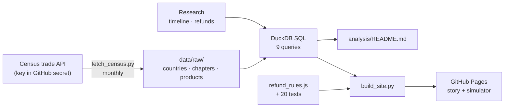

# Tariff Whiplash

**What did US tariffs actually cost in 2025–26, and where did the buying go?**

👉 **[Read the data story](https://shre0027.github.io/tariff-whiplash/)** · [Cost simulator](https://shre0027.github.io/tariff-whiplash/simulator.html) · [Case study](docs/case-study.md) · [SQL analysis](analysis/README.md) · [Process maps](docs/process-maps.md) · [Requirements](docs/requirements.md) · [Decision log](docs/decision-log.md) · [Data dictionary](docs/data-dictionary.md) · [Research notes](docs/research-notes.md)

In 2025 the tariff rate US importers actually paid more than quadrupled. In February 2026 the Supreme Court struck most of the new tariffs down, and in July 2026 new ones replaced part of them. This project uses the Census Bureau's own trade data to show what importers really paid, which countries and products gained and lost, and how the refunds work, plus a simulator to compare where to buy from today.

Facts only: no view on whether the tariffs are good policy.

## Key findings
*(January–August of each year; Census data through August 2026)*

- **Headline vs reality:** the effective US tariff rate rose from 2.2% (Jan 2025) to 10.8% (Oct 2025), and was 6.9% in Aug 2026. Goods from China peaked at 47.9%, a third of the 145% headline.
- **The bill:** duty charged went from $50B (2024) to $150B (2025) and $174B (2026), while imports grew 12%.
- **Where it went:** China's share of US imports fell from 12.9% to 7.4%. Taiwan, Vietnam, Thailand and Mexico gained the most.
- **Fastest moves:** laptops from China went from 67% to 7% of US imports; India now supplies 49% of US smartphones (17% in early 2024).
- **Today:** steel products pay 43%, clothing about 23%; phones and laptops under 1%.
- **Method check:** extra duty in goods mainly hit by the struck-down tariffs is $150B in the data, against CBP's reported $166B collected.

## What's in it
1. **Data pipeline:** monthly download from the Census international trade API (country, product group, 6- and 10-digit product), on GitHub Actions
2. **SQL analysis:** nine documented DuckDB queries, results in [`analysis/`](analysis/README.md)
3. **Data story:** scroll-driven page; every number is filled from the data
4. **Refund route checker:** IEEPA refund rules R1–R8 as code, with 20 tests
5. **Sourcing cost simulator:** cost to land $100 of goods from each country, with a "what if" on China's tariff
6. **BA documents:** process maps, requirements (site + a BRD for an internal tariff and refund tracker), decision log, data dictionary, case study

## How it works



| Step | File | What it does |
|---|---|---|
| Download | `scripts/fetch_census.py`, `.github/workflows/fetch.yml` | Pulls monthly data on the 12th; the API key is a repository secret and is never printed |
| Analyze | `sql/*.sql`, `scripts/run_sql.py` | Runs every query and writes results to `analysis/` |
| Rules | `templates/refund_rules.js`, `tests/` | Refund routes; tests run on every build (`node --test tests/*.test.js`) |
| Publish | `scripts/build_site.py`, `templates/`, `.github/workflows/pages.yml` | Builds the two pages with the data embedded and publishes them |

Run it yourself:
```bash
export CENSUS_API_KEY=...   # free key from api.census.gov/data/key_signup.html
python scripts/fetch_census.py
pip install duckdb && python scripts/run_sql.py && python scripts/build_site.py
```

## Data source
US Census Bureau, international trade data (imports by HS code): imports for consumption, calculated duty, freight and insurance charges. Tariff events and refund figures come from published legal and trade sources, listed in the [research notes](docs/research-notes.md).

*Calculated duty is assessed at entry; refunds paid later are not subtracted. Not legal advice.*

Built by Shreyas Tayde with Claude.
