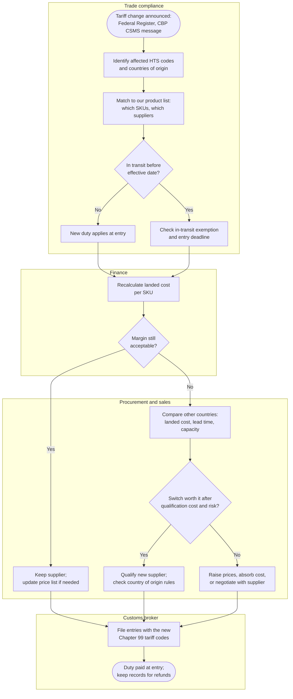
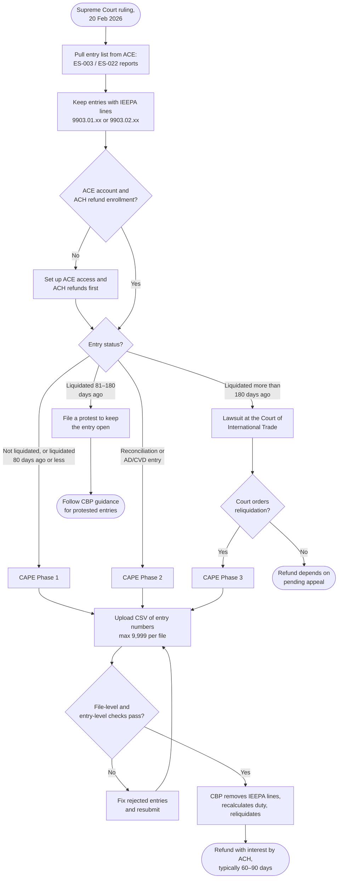

# Process maps

> Two processes a business analyst at an importing company would need to understand: what happens inside the company when a tariff changes, and how the company gets struck-down tariffs back. Both are drawn from the rules in the [research notes](research-notes.md). They describe a typical mid-sized importer that uses a customs broker; a real company's roles would be confirmed in stakeholder interviews.

## 1. When a tariff changes: how an importer responds

**Why it matters:** in 2025–26 tariff rates changed more than a dozen times (see the [timeline](../data/reference/timeline.json)). Each change hit goods already on the water, prices already quoted to customers and suppliers already contracted. The data shows the result: importers moved sourcing away from China within months.

**Pain points a requirements effort would target:**

| # | Pain point | Effect | Requirement it leads to |
|---|---|---|---|
| P1 | Changes announced days before they take effect | No time to recalculate thousands of SKUs by hand | Automatic landed-cost recalculation when a rate changes |
| P2 | Product lists don't store HTS code and country of origin together | Can't tell which SKUs a change hits | One product master with HTS code, origin and supplier |
| P3 | Several tariffs stack on one product (Section 232, 301, IEEPA) | Duty is underestimated | Rules that apply each program and its exclusions in order |
| P4 | Supplier switches take months (qualification, tooling, origin checks) | Decisions based on today's rate may be wrong by the time they land | Show the rate history and pending changes next to the cost |

## 2. Getting struck-down tariffs back: the CAPE refund process

**Why it matters:** about $166 billion of IEEPA tariffs were collected; about $126 billion had been sent for payment by 2 October 2026. Whether an entry can still be refunded depends on dates, so missing a deadline can forfeit money.

**Business rules the map depends on** (used by the refund-route checker on the site and its tests):

| Rule | Statement | Source |
|---|---|---|
| R1 | Only the importer of record can file; a broker gets paid only with a Form 4811 on file before the claim | Brady Ware FAQ |
| R2 | An entry qualifies for Phase 1 if it is unliquidated or was liquidated 80 days ago or less | Brady Ware FAQ |
| R3 | Reconciliation (type 09) and AD/CVD entries go through Phase 2 | Brady Ware FAQ |
| R4 | 81–180 days after liquidation, a protest keeps the entry open | 19 U.S.C. § 1514 |
| R5 | More than 180 days after liquidation, only a court action applies; Phase 3 needs a court order | 28 U.S.C. § 1581(i); CBP, as reported |
| R6 | A declaration can't be edited or withdrawn after upload | Brady Ware FAQ |
| R7 | No paper checks: refunds need ACH enrollment | Brady Ware FAQ |
| R8 | Section 122, 232 and 301 duties are not refunded through CAPE | Brady Ware FAQ |
